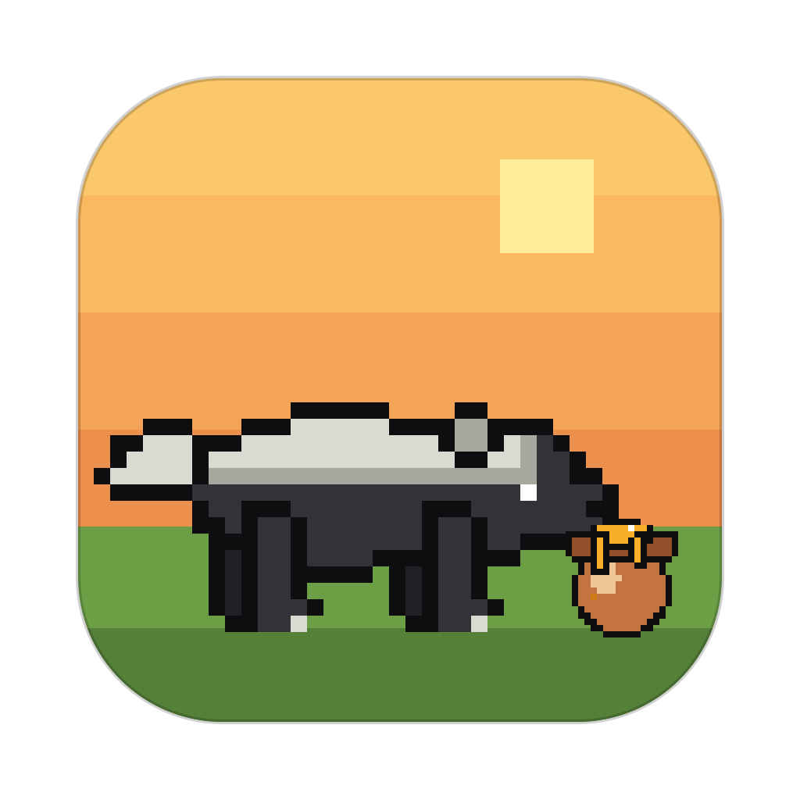
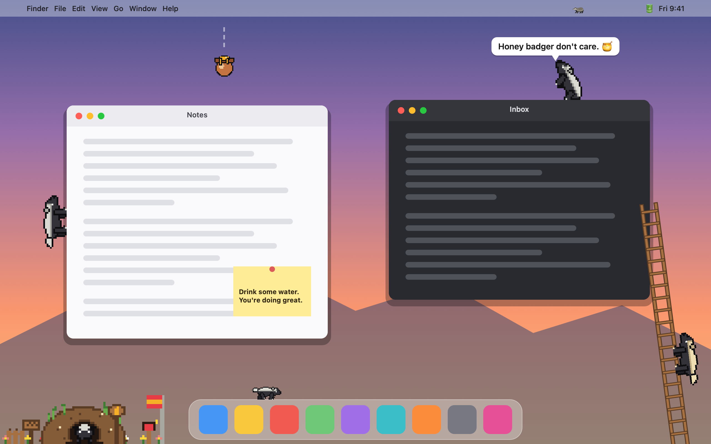
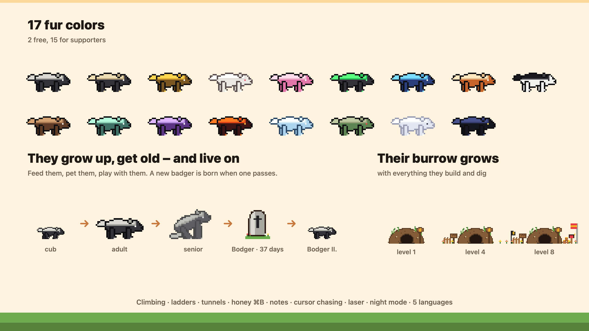

<p align="center"></p>

<h1 align="center">Badgertop 🦡</h1>
<p align="center"><b>Two honey badgers. Zero cares.</b><br>
A tiny desktop companion for macOS – two pixel honey badgers that live on your screen.</p>

<p align="center">
  <a href="https://github.com/Daivemasa/badgertop/releases/latest/download/Badgertop.dmg"><b>⬇️ Download for Mac</b></a> ·
  <a href="https://daivemasa.github.io/badgertop/">🌐 Website</a> ·
  <a href="https://badgertop.gumroad.com/l/badgertop">☕ Upgrade or support with any amount</a>
</p>

<p align="center"></p>

They climb your windows and the Dock, build ladders out of sticks, dig tunnels, wrestle, chase your cursor,
bring you reminder notes, eat whatever grows on your desktop, grow old – and they really, truly do not care.

**Just for calm.** Badgertop is a little something for long days at the computer – a small distraction when you need one.
They won't create anything for you, they won't cook your dinner. They'll just be there with you – and hopefully you'll be glad they are.

<p align="center"></p>

## Free
- **Two badgers** that climb window edges, sides and undersides, swing over corners and leap between windows
- They **build** ladders, branches and bridges between windows (move the window and the badger *loses it*)
- **Tunnels** – they dig into one window and pop out of another
- They **play together**: tag, dust-cloud fights, head bonks, hide and seek, little conversations
- **They live**: they grow up, get old and grey, and one day pass away – a little grave appears and a new badger is born
- **Care**: honey (⌘B), petting and play keep them healthy; neglected badgers get sick. Keep a daily streak 🔥 and they live longer
- A **burrow** that grows with their work – sign, flowers, fence, flag, mailbox, lantern, a pyramid of honey pots
- **Reminder notes** delivered in their mouths, cursor chasing, laser pointer, night mode
- A big welcome show on first launch, hundreds of lines, 30+ pixel animations, English UI

## Supporter bonuses ❤️ – any amount, starting at one espresso
- **15 extra fur colors** (golden, albino, panda, zombie, night with glowing eyes…)
- **The cub** – follows its parents and copies everything they do
- **Food from nature** – apple trees that grow, worms, moles that sometimes escape (plus the gross stuff)
- **“A lot” annoyance** and more frequent notes
- **More languages**: Czech, German, Spanish, French
- **Settings for almost everything**: speed, climbing, jumping, tunnels, talking, sleeping, playing, custom names

This whole project is free. If you like it, I'd be really happy if you bought me a coffee ☕ –
the minimum is $3 only because of payment fees, how much you give is entirely up to you.

👉 **[Get the unlock code](https://badgertop.gumroad.com/l/badgertop)**, then click 🦡 in the menu bar → *Enter license key…*

## Install
1. Download `Badgertop-x.y.z.dmg` from **[Releases](https://github.com/Daivemasa/badgertop/releases/latest)**, open it and drag Badgertop into **Applications**.
2. Launch it once – macOS will block it. Then go to *System Settings → Privacy & Security*, scroll down and click **Open Anyway**.
   Badgertop isn't notarized (Apple charges $99/year for that), so this is the only way to start it the first time.
3. Look for 🦡 in the menu bar. Settings: **⌘,**

Updates: once a day Badgertop checks this page – when a new version is out, a badger brings you a note.

Requires macOS 13 Ventura or newer, Apple Silicon or Intel.

### Privacy
- Reads only window **positions** and the name of the active app – never window contents or what you type.
- Sends nothing anywhere. The only network request is a daily check of this repository's latest release.
- No special permissions needed.

## Build from source
Only Xcode Command Line Tools are needed (`xcode-select --install`):

```bash
./build.sh        # build into ~/Applications and launch
./release.sh      # dist/Badgertop-<version>.zip + .dmg
```

| File | What's inside |
|---|---|
| `main.swift` | behaviour, physics, windows, burrow, items, menu |
| `Life.swift` | age, health, death, graves, births, burrow levels |
| `Pixel.swift` | procedural pixel-art sprites, fur colors, critters |
| `Lang.swift`, `Lines*.swift`, `UIText.swift` | lines and UI in 5 languages |
| `Settings.swift` | settings window (SwiftUI) |
| `Store.swift` | supporter unlock and update check |
| `tools/promo` | renders the images in this README from the app's sprites |

## Česky
Dva pixeloví medojedi na tvém Macu – lezou po oknech a Docku, staví si žebříky, prohrabávají se tunely, stárnou a je jim všechno u prdele.
Zdarma v angličtině; čeština a další bonusy pro podporovatele (od ceny jednoho espressa).

## License
MIT – see [LICENSE](LICENSE). Inspired by a certain viral honey badger video; all texts and graphics are original.
